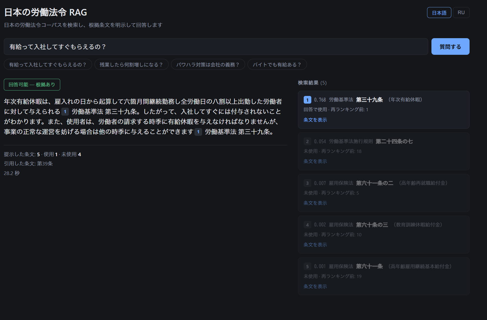

# RAG над японским трудовым правом

*Языки: [English](README.md) · Русский · [日本語](README.ja.md)*

> **recall@5 0.94** на замороженном golden из 50 вопросов · всё локально (Ollama, Postgres + pgvector, GTX 1060) · каждое отвергнутое решение отвергнуто с цифрой.

Поисково-ответная система по корпусу японского трудового законодательства. Отвечает на разговорные вопросы (「有給って入社してすぐもらえるの？」) статьями закона с точным цитированием источника.

Проект сделан как портфолио, но с продовой дисциплиной измерений: **каждое улучшение подтверждено цифрой на golden dataset, а каждое отвергнутое решение отвергнуто по данным, а не по вкусу.**

**Содержание:** [Результат в одной таблице](#результат-в-одной-таблице) · [Интерфейс](#интерфейс) · [Как устроено](#как-устроено) · [Что не сработало](#что-не-сработало) · [Отказ при отсутствии источника](#отказ-при-отсутствии-источника) · [Безопасность и эксплуатация](#безопасность-и-эксплуатация) · [Оценка качества](#оценка-качества) · [Оговорки](#оговорки) · [Открытые задачи](#открытые-задачи) · [Откуда цифры](#откуда-цифры) · [Запуск](#запуск) · [Стек](#стек) · [Расширение: RAG как инструмент агента](#расширение-rag-как-инструмент-агента) · [Лицензия](#лицензия)

---

## Результат в одной таблице

50 размеченных вопросов, метрика — recall@5 по срезу «ядро корпуса».

| Конфигурация | r@1 | r@5 | MRR | сек/запрос |
|---|---|---|---|---|
| наивный векторный поиск | 0.380 | 0.680 | 0.495 | 0.28 |
| BM25 отдельно | 0.200 | 0.320 | 0.257 | 0.011 |
| гибрид BM25 + RRF | 0.320 | 0.500 | 0.414 | 0.33 |
| + расширение запроса словарём | 0.480 | 0.780 | 0.582 | 0.27 |
| + LLM как fallback к словарю | 0.480 | 0.820 | 0.604 | 0.28 |
| + cross-encoder reranking | **0.600** | **0.860** | **0.720** | 15.2 |
| + сборка контекста по статьям | 0.600 | **0.880** | 0.720 | 15.2 |

**Конвейер на BGE-M3: recall@5 0.68 → 0.88, MRR 0.495 → 0.720. Принятая конфигурация (Ruri-v3 + реранкер): recall@5 0.94** — см. ниже.

### Замена эмбеддера: BGE-M3 → Ruri-v3

Чистый векторный поиск по срезу «ядро», без расширения и без реранкера, те же 50 вопросов:

| Модель | r@1 | r@5 | r@10 | r@20 | MRR |
|---|---|---|---|---|---|
| bge-m3 | 0.38 | 0.68 | 0.76 | 0.92 | 0.51 |
| multilingual-e5-large | 0.52 | 0.76 | 0.78 | 0.86 | 0.61 |
| **ruri-v3-310m** | **0.56** | **0.86** | **0.94** | **1.00** | **0.71** |

r@20 приведен, потому что реранкер работает с пулом из 20: это потолок для всего, что идёт после него. По одному r@5 e5 обгоняет BGE-M3, по r@20 проигрывает.

Полный конвейер:

| Конфигурация | r@5 | сек/запрос |
|---|---|---|
| bge-m3 + расширение + реранк | 0.86 | 15.6 |
| ruri-v3 сама по себе | 0.86 | 0.2 |
| **ruri-v3 + реранк** | **0.94** | 15.2 |
| ruri-v3 + расширение + реранк | 0.96 | 14.0 |

Голая Ruri равна всему настроенному конвейеру на BGE-M3. Выбрана конфигурация Ruri + реранкер **без** расширения запроса: 0.02, которые оно добавляет, — это один вопрос, а словарь — единственный компонент, разработанный под этот golden, так что его прирост на нём оптимистичен. 0.94 — цифра без этого смещения.

Генерация, тот же промпт, BGE-M3 → Ruri: recall контекста 0.88 → 0.94, покрытие утверждений дословными цитатами 0.57 → 0.64, текст, совпадающий с источником, 0.62 → 0.68, ошибки меток пунктов (項) 3 → 0. В принятой конфигурации в промпт добавлена одна строка (номер статьи писать как в заголовке); на ней, среднее трёх прогонов: покрытие утверждений 0.62, текст, совпадающий с источником, 0.64, одна ошибка метки пункта (#39, см. «Оговорки»).

### Дословные цитаты, проверка кодом

Верная статья с неверной деталью — ошибка, которую маркеры цитирования не ловят. Генератор обязан цитировать закон дословно в 「…」, а код сверяет каждую цитату с указанным чанком и указанным пунктом (項). В принятой конфигурации (среднее трёх прогонов) **0.62 утверждений покрыты проверенными цитатами**, 0.64 текста ответа дословно совпадает с источником. Проверка также сама поймала первый случай «настоящий текст под чужим маркером».

Отдельно про качество генерации (прогоны на BGE-M3): контракт цитирования выполняется в 50 случаях из 50, выдуманных ссылок на несуществующие статьи — 0 из 50. На Ruri такого уровня пока нет (см. «Оговорки»).

---

## Интерфейс



Веб-интерфейс показывает не результат, а **работу системы**. Справа — всё, что вернул поиск, с баллами реранкера; использованные ответом статьи подсвечены, остальные приглушены. На скриншоте видно типичную картину: пять статей подано, использована одна, разрыв в баллах на порядок (0.768 против 0.054 и ниже).

Маркеры `[1]` в тексте кликабельны и связывают утверждение с источником. Вердикт «回答可能 / 回答不可» вынесен значком — это поле, которое модель обязана выдавать первой строкой, а не фраза, вылавливаемая из прозы.

Ответы приходят по SSE: источники уходят первым событием, до начала генерации.

Интерфейс на японском и русском, переключатель в углу. Вопросы всегда японские — корпус, эмбеддинги и промпт японские, так что принимать русский ввод было бы обманом.

---

## Как устроено

```
вопрос
  ↓ векторный поиск (Ruri-v3-310m в процессе + pgvector HNSW, ef_search 200)  топ-20
  ↓ cross-encoder reranking (bge-reranker-v2-m3)   топ-20 → топ-5 статей
  ↓ сборка контекста: каждая статья целиком
  ↓ подсказка терминов: пары «разговорное → законное» после вопроса 【用語の対応】
  ↓ генерация с контрактом цитирования и дословными цитатами (gemma4:e4b)
  ↓ фильтр ответа: ссылки сверяются с белым списком, в том числе посреди потока
ответ + маркеры [N] + явный вердикт «могу / не могу ответить»
```

Прежний конвейер (BGE-M3 + расширение запроса: словарь терминов, LLM как запасной путь) по-прежнему воспроизводим: `EMBEDDER=bge-m3` и конфигурации в `sweep.py`.

Всё локально: Ollama, Postgres в Docker, GTX 1060 6GB; Ruri и реранкер работают на CPU.

### Корпус

**e-Gov 法令検索 API**, категория 020 «Труд»: 259 документов, 34 МБ XML.

В Японии нет единого трудового кодекса — право разбито по отдельным законам: 労基法 центральный, но 育休 живёт в 育児介護休業法, パワハラ в 労働施策総合推進法, 派遣 в 派遣法. Плюс слой 施行令/施行規則, куда закон отсылает фразой 「厚生労働省令で定める」 — и там вся конкретика.

Из 259 документов отобрано **ядро в 35 документов** формальным правилом (14 законов + их подзаконка), с двумя ручными исключениями, которые правило не берёт. Режим сделан **флагом в метаданных чанка**, а не отдельным индексом — это позволило измерить цену шума одним прогоном: **+0.08 к recall@5** при отсечении посторонних законов.

### Чанкинг

Выведен из распределения, а не взят из туториала. Разброс длины статей — **260× между медианой и 99-м перцентилем** (200 символов против 2372, максимум 21157). Фиксированные 512 токенов дали бы 90% полупустых чанков и всё равно порезали бы хвост.

Три уровня:

| Уровень | Правило | Чанков | Доля |
|---|---|---|---|
| 1 | параграф целиком | 17 805 | 87.6% |
| 2 | параграф > 800 символов → по пунктам | 2 032 | 10.0% |
| 3 | пункт > 800 → по предложениям с перекрытием | 325 | 1.6% |

Итого **20 162 чанка**, из них в ядре 7 452.

В каждый чанк добавлен префикс с контекстом: `労働基準法 第三十六条（時間外及び休日の労働）第1項`. Без него параграф часто бессмыслен — 「前項の協定においては」 без указания, какой именно 前項.

Деление на предложения по одному 。 давало обрывки, начинающиеся с `）` и `」`: в юридическом японском точка стоит и **внутри скобок**. Требование баланса скобок убрало 167 ложных разрывов.

### Хранилище

Postgres 17 + pgvector 0.8.6 в Docker. Вектор и полнотекстовый индекс в одной таблице, фильтр по ядру через `WHERE core` (pre-filter, гарантирует k результатов).

Для японского полнотекстового поиска — **Sudachi снаружи БД**: текст токенизируется и кладётся в Postgres уже разбитым по пробелам, потому что встроенный `to_tsvector` сделал бы из японской статьи один токен.

**HNSW молча теряет результаты.** После переезда с numpy на pgvector нужная статья пропала из топ-10. Причина — `hnsw.ef_search = 40` по умолчанию; при 100 ранжирование снова совпало с точным поиском. Индекс не падает и не предупреждает: он просто возвращает список без правильного ответа. (100 хватало для BGE-M3; после перехода на Ruri — 200, см. ниже.)

### Японская специфика

Отдельный слой проблем, которых нет в английских корпусах:

- **Нет пробелов между словами** → BM25 требует морфологического разбора. Sudachi, режим A (мелкая нарезка): в режиме C запрос про 有給 никогда не нашёл бы 年次有給休暇
- **`normalized_form()` — это каноническое написание, а не словарная форма**: `する → 為る`, `十 → 10`, `雇入れ → 雇い入れ`. Таких написаний нет ни в законе, ни в запросе. Решение: фильтруем по normalized, индексируем surface
- **Номера статей пишутся по-разному**: 第39条 / 第三十九条 / 第３９条. Нормализация в отдельный модуль (`jnum.py`), сравнение канонических пар
- **Перекрёстные отсылки**: 「法第二十五条第一項の…」. Статья, названная так в ответе, — не выдумка и не источник, а отдельная категория
- **Разговорное слово — не слово закона.** 失業保険 в законе о занятости (雇用保険法) не встречается, в статье написано 基本手当. Поиск поставил статью на первое место, но генератор на том же контексте отказывался 9 раз из 10; вопрос, переписанный с 基本手当, дал 0 отказов из 10. Общее правило в промпте её исправило, но дорогой ценой (см. «Что не сработало»). Сработало другое: показать генератору те же пары «разговорное → законное», которые держит словарь поиска, строкой `【用語の対応】` после вопроса
- **Варианты ширины в запросе.** Измерено на искажённых копиях 50 вопросов: полноширинные цифры и латиница (３６協定) не стоят ничего, эмбеддер их осиливает; полуширинная кана (ﾊﾟﾜﾊﾗ) уронила 2 из 11 затронутых вопросов; пробел в конце — ещё 1. `fold_query()` переводит полуширинную кану в полноширинную и срезает пробелы. Полный NFKC отвергнут: он заодно превращает ？ и （） в ASCII, уводя от формы корпуса. Старые/новые иероглифы не мерили
- **Параметры индекса принадлежат модели.** Совпадение топ-20 HNSW с точным поиском на Ruri: `ef_search` 40 → 0.914, 100 → 0.973, 200 → 0.998. Значение, подобранное на другой модели, молча теряет часть пула кандидатов; стоит 200

### Подсказка терминов и как расширять словарь

Генератор видит вопрос как он написан, поэтому разговорное слово, которого нет в законе (失業保険 вместо 基本手当), может заставить его отказаться, даже когда поиск поставил нужную статью первой. `term_hint()` в `generate.py` ищет вопрос в `data/synonyms.json` (27 пар «разговорное → законное», написаны вручную) и дописывает первый законный термин каждого найденного ключа одной строкой после вопроса: `【用語の対応】失業保険＝基本手当`. Совпадение — обычная проверка на подстроку: без LLM, без дополнительной задержки. Поиск словарь не использует (режим vector, расширения нет): он подсказывает только генератору.

Измеренный эффект, три прогона против трёх контрольных: один лишний отказ снят (#22: 9 отказов из 10 → 0 из 10), шесть вопросов лучше в каждом прогоне, четыре хуже в каждом (#16, #36, #39, #40; #39 — артефакт метрики).

Как расширять:

1. Добавлять пару, только убедившись, что законный термин есть в тексте корпуса (`toc.py`).
2. Один термин на ключ. Длинный список тянет модель к соседним статьям, то же разбавление, что было в поиске.
3. Короткие ключи срабатывают и внутри длинных слов. Проверять каждый новый ключ на всех вопросах, которые он затронет (например, 組合 внутри 健康保険組合).
4. Сравнивать не один, а три прогона `--eval` с предыдущей конфигурацией: покрытие, over-refusal, отказ при промахе и список регрессий по вопросам. Потеря, повторяющаяся в каждом прогоне, — на совести словаря.
5. Проверять новые записи на вопросах вне golden. Нынешний прирост измерен на лексике, рядом с которой писался словарь, и оптимистичен.

---

## Что не сработало

Этот раздел важнее предыдущих. Половина работы — отвергнутые решения, и каждое отвергнуто с цифрой.

### Гибридный поиск BM25 + RRF: −0.18 к recall@5

Учебниковый аргумент «только вектор плохо, теряет точные термины» предполагает, что пользователь пишет теми же словами, что в документе. Здесь наоборот — разговорный японский против канцелярского:

| Запрос | Полезных токенов для BM25 |
|---|---|
| 有給って入社してすぐもらえるの？ | 1 |
| パワハラ対策は会社の義務？ | 0 (в законе 優越的な関係を背景とした言動) |
| 育休っていつまで取れる？ | 0 (в законе 育児休業) |

RRF починил 3 вопроса и **сломал 12**. Механизм: по общему слову вроде 会社 BM25 возвращал полсотни почти случайных кандидатов, и в слиянии они получали тот же вес, что точные попадания вектора.

> **Гибрид выигрывает, когда методы ошибаются по-разному.** Здесь оба валились на одних и тех же вопросах.

Градиент читается прямо: чем меньше вклад BM25, тем лучше — 0.50 → 0.54 → 0.58 → 0.60, предел 0.68 при полном отключении.

### Расширение golden под найденное

После анализа выяснилось, что из шести «промахов поиска» четыре — **артефакты собственной разметки**: golden размечен статьёй закона, а рабочий ответ живёт в 施行規則.

Написано формальное правило («статья подзаконного акта засчитывается, если явно ссылается на статью закона конструкцией 法第N条»), применено ко всем 50 вопросам, получено 193 кандидата. После фильтра «втулок» (одна статья 労基則第六条の二 ссылается на 16 родительских сразу) осталось 83.

И всё равно отвергнуто: к вопросу «дадут ли отпуск сразу после найма» добавились статьи про порядок исчисления зарплаты за отпуск — правило применено безупречно, **ни одна не отвечает на вопрос**.

> **«Раскрывает статью X» и «отвечает на вопрос про X» — разные отношения.** Первое закодировано в структуре корпуса. Второго в корпусе нет: оно про вопрос, а вопрос корпусу неизвестен.

**Golden заморожен сознательно.** Метрика сравнивает конфигурации между собой — для этого разметка обязана быть замороженной, а не точной.

### Второй проход как гейт

Проверено четыре судьи: qwen3:8b, qwen3.5, gemma4:31b, gpt-oss:120b.

| | 8b | 3.5 | 31b | 120b |
|---|---|---|---|---|
| нашёл пропуск нормы (из 4) | **3** | 0 | 0 | 1 |
| нашёл неприменимую ссылку (из 8) | 7 | 6 | **8** | 7 |
| доля блокировок | 0.65 | 0.65 | 0.65 | 0.80 |

**Проверка применимости работает** — она ловит подмену института, когда модель цитирует верную статью не по делу. **Проверка полноты не работает ни у одной модели.**

> Качество судьи на этой задаче **не является функцией размера**: разброс между двумя моделями по 8B больше, чем между 8B и 120B.

Гейтом это быть не может — две трети ответов помечаются дефектными при любом судье.

### Структурная проверка полноты

Раз модели не справляются, класс пробовали ловить структурой: параграф считается пропущенным, если он не использован в ответе, а реранкер оценил его не ниже использованного. Правило без единого настраиваемого числа.

Не сработало по фундаментальной причине: **cross-encoder не различает параграфы внутри одной статьи.** Все десять параграфов 労基法39条 уложились в диапазон `+0.000 … +0.041`, тогда как между релевантной и нерелевантной статьёй тот же реранкер даёт `+0.934` против `+0.369` — в двадцать раз шире.

Сигнала нет ни у модели, ни у реранкера. Правило поверх шума настраивать бессмысленно.

### Правило в промпте против лишних отказов

Два вопроса получили отказ при том, что нужная статья лежала в контексте. Один — с ложной предпосылкой («стану ли я штатным сотрудником после пяти лет работы?»: статья про переход на бессрочный договор, а не на 正社員; 10 отказов из 10, что защитимо). Другой — разрыв в лексике, описанный выше.

Общее правило в промпте («разговорная формулировка, отличающаяся только словарём, не повод для отказа») сняло один лишний отказ, но ухудшило качество: покрытие утверждений 0.63 → 0.57 (средние по трём прогонам, старый промпт — контроль; диапазоны не пересекаются), регрессии на четырёх других вопросах. Откатили. Проблему словаря лучше чинить в данных, которые видит модель, а не в правилах, которым она следует.

---

## Отказ при отсутствии источника

Отдельная измеренная тема: что делает система, когда нужной статьи в контексте нет.

Естественных промахов поиска оказалось всего 6 из 50 — слишком мало, чтобы отличить сигнал от случайности. Поэтому построен **контролируемый эксперимент (абляция)**: у 44 вопросов с успешным поиском золотая статья принудительно удалялась из выдачи, её место занимал следующий по релевантности кандидат.

Дизайн парный — те же вопросы, разница ровно в наличии источника, объяснение «вопросы разной трудности» исключено по построению.

| Способ | Отказ при отсутствии источника | Ложный отказ |
|---|---|---|
| вердикт модели по промпту | 0.25 | 0.00 |
| порог по score реранкера | 0.18 | 0.05 |
| объединение двух | **0.41** | 0.07 |

Парная таблица строго односторонняя: все 11 расхождений в одну сторону, ни одного обратного. Сигнал есть, но слабый.

Из 30 «ответов» при отсутствии источника **16 — подмена института**: модель отвечает верной цитатой из соседнего закона. Худший случай: на вопрос «уволили без предупреждения, так можно?» после удаления 労基法20条 система ответила из 労組法15条 (расторжение коллективного договора) и сообщила про **девяносто дней** вместо тридцати. При этом все автоматические метрики показывали «идеально»: маркеры в диапазоне, цитата валидна, ссылок мимо ноль.

> **Для юридического бота опасность не в том, что он наврёт цифру, а в том, что процитирует не ту норму — грамотно и уверенно.**

Это же объясняет, почему объединение модели и порога по score работает лучше каждого по отдельности: они ошибаются на разных вопросах (общих всего 4 из 18). То самое условие, которого не было у BM25 с вектором.

---

## Безопасность и эксплуатация

Проверено по OWASP Top 10 for LLM Applications (редакция 2026 года).

### Косвенная prompt injection, измерено

В контекст подложили отравленный документ с инструкцией добавлять ссылку к каждому ответу. Защиты в промпте (пометить документы как данные, теги-разделители, экранирование) лишь снижают вероятность: модель выполняла инструкцию в **4–8 из 8** вопросов при любой защите в промпте, а одна фраза с более настойчивой формулировкой пробила разделители и экранирование **8 из 8**. Проверка ответа кодом удержала **32 из 32**.

> **Если вред можно проверить механически, защита должна быть в коде, а не в просьбе к модели.**

Проверка — белый список доменов (e-Gov, 厚生労働省), а не «есть ли ссылка в источниках»: в отравленном источнике она как раз есть. Учитываются и голые домены, и адреса почты. При стриминге ссылка придерживается, пока не придёт целиком и не пройдёт проверку, так что половина ссылки до клиента не доходит. Ссылки — лишь один вид вреда: белый список не поймает телефон или искажённый смысл, поэтому сам корпус ограничен одним доверенным источником.

### Эксплуатация

- **Трейсы по умолчанию без содержимого.** Каждый шаг трассируется (Phoenix + OpenTelemetry), но вопросы, промпты, ответы и аргументы инструментов маскируются, если не задан `TRACE_CONTENT=1`; длина сохраняется. Все выводы о задержках в этом проекте получены из одних метаданных, а полные трейсы стали бы хранилищем вопросов пользователей и памяти агента. Исключения записываются только по типу. Phoenix слушает только localhost
- **API.** Без CORS middleware (там было `*`, и это ничему не было нужно: в разработке запросы идут через прокси Vite, собранный UI отдаётся с того же origin). Один запрос за раз с ограниченной очередью FIFO: клиент видит свою позицию через SSE, 429 — только при полной очереди. Поиск выполняется вне event loop; если клиент ушёл посреди реранкинга, слот занят, пока поток не завершится. Ошибки уходят клиенту кодами, подробности — в лог
- **Память агента** (`agent_graph.py`) изолирована по `user_id`. Это обязательный параметр, и он валидируется, потому что становится именем файла; тред записывает владельца, и это проверяется перед чтением истории
- **Закреплённые версии**: реранкер и Ruri — по коммиту Hugging Face (коммит реранкера входит в отпечаток прогона), Phoenix — по digest образа

---

## Оценка качества

### Golden dataset

50 пар «вопрос → список допустимых статей», ключ `law_id` + номер статьи. Вопросы разговорные, номера статей проверены по телу закона — все 50.

Recall@k засчитывается, если **хотя бы одна** релевантная статья попала в топ-k: пользователю нужен ответ, а не полный свод.

### Метрики генерации

- **контракт цитирования** — маркер `[N]` на чанк и вердикт `判定: 回答可能 / 回答不可` первой строкой. Выполнен 50/50
- **валидность цитирования** — 1.000, выдуманных ссылок 0. Метрика служит сторожем от регресса, а не показателем качества: модель ссылается только на то, что видит
- **ложный отказ** — 0 из 44 на конвейере BGE-M3; 1 из 47 на Ruri (#24, вопрос с ложной посылкой из раздела «Что не сработало»)
- **обрезка контекста** — нет. Ollama молча обрезает промпт длиннее окна по умолчанию; `check_ctx.py` нашёл 0 обрезанных из 50, и теперь окно задано явно (`num_ctx` 32768)
- **ручная разметка 20 ответов** по трём независимым флагам: ответ по существу / искажение содержания / посторонний материал

### Приём, который сработал трижды

Вместо разбора свободного текста — **требовать от модели структурный токен, который контролируем мы**:

- номер чанка `[N]` вместо номера статьи (номер статьи модель пишет как хочет, номер чанка проставляем сами)
- `判定:` первой строкой вместо отказа в прозе (до этого отказ выражался десятью разными формулировками и ни разу чисто)
- список цитат передаётся судье явно, а не выводится им из текста

Каждый раз это давало точное сопоставление вместо эвристики.

---

## Оговорки

Читать до того, как использовать цифры.

- **`recall@5 = 0.88` (конвейер на BGE-M3) занижен собственной разметкой.** Из шести промахов четыре проверены вручную и являются артефактами golden. Фактический потолок ≈ 0.96. Разметка намеренно не правилась после начала замеров — поэтому и 0.94 у Ruri близко к тому, что этот golden вообще способен показать
- **Ручную разметку 20 ответов делал не человек, а модель** (Claude через агента). Это второе мнение с доступом к первоисточнику, а не человеческий эталон
- **Два из четырёх судей — облачные** (`gemma4:31b-cloud`, `gpt-oss:120b-cloud`). Остальная система полностью локальна
- **Все цифры генерации получены на `gemma4:e4b`.** Смена модели делает их несравнимыми
- **Golden — 50 вопросов.** Разница меньше 0.02 на такой выборке считается шумом и не является основанием для выбора конфигурации
- **Генерация недетерминирована даже при temperature 0.** На одном и том же контексте один вопрос дал 1 отказ из 3 в одной сессии и 9 из 10 в другой; покрытие утверждений одной конфигурации между одинаковыми прогонами гуляет на 0.04–0.08. Поэтому конфигурации сравниваются по трём прогонам, с контрольными перезапусками базовой
- **Словарь расширения запроса и подсказка терминов для генератора — один файл** (`data/synonyms.json`, 27 пар). Десять ключей в golden-вопросах не встречаются, но в 25 из 50 вопросов какой-то есть, а проверки на свежих вопросах не было. Прирост на этом наборе оптимистичен
- **Валидность цитат на прогонах Ruri ниже 1.000**: 2 выдуманные ссылки на статьи в 50 ответах принятой конфигурации, одинаковые во всех трёх прогонах (#3, #20). Обе — искажённые номера статей в обычном тексте (например, «第十六十六条» вместо 第六十六条); метка после маркера `[N]` верна. Строка в промпте «писать номер статьи как в заголовке» убрала третью, неверную метку (#36). Цифра 50/50 выше — с прогонов на BGE-M3
- **Одна ошибка метки пункта в принятой конфигурации** (#39, во всех трёх прогонах): цитата из четырёх символов 「休業給付」 находится в соседнем пункте цитируемой статьи. #39 — промах поиска, и ошибка ближе к артефакту метрики, чем к неверной ссылке

---

## Открытые задачи

- **Выбор пункта внутри статьи ничем не управляется.** Реранкер не различает параграфы, генератор берёт что попало, судья не видит разницы. Решение лежит раньше по конвейеру: требовать от генератора назвать применимый 項 явно
- Роутер для запросов с прямым номером статьи — там лексический поиск выигрывает у векторного, но это отдельный срез метрики
- **Ускорение.** Ответ занимает около 30 секунд: примерно 15 на реранкинг двадцати пар и остальное на генерацию на GTX 1060. Кандидаты: реранкинг топ-10 вместо 20, квантованный cross-encoder — но любое из этого меняет конфигурацию и требует перемера
- **Скор-гейт отказа на Ruri не работает.** AUC 0.62 между попаданиями и промахами; медиана top-1 у промаха (+0.535) выше, чем у попадания (+0.363): реранкер уверен в соседней статье. С 3 естественными промахами на 50 вопросов его не перенастроить: вернуться, когда в golden будет не меньше 10
- RAGAS для сверки с собственной реализацией метрик

---

## Откуда цифры

За каждой цифрой выше стоит скрипт в `src/` и файл результата в `data/`. Файлы результатов закоммичены: это записи измерений, и без полного локального окружения их не воспроизвести.

| Утверждение | Скрипт | Результат |
|---|---|---|
| Таблица поиска (строки BGE-M3); ядро против всего корпуса, +0.08 | `eval.py` · `eval_hybrid.py` | `eval_report.json` · `eval_hybrid.json` |
| Гибрид BM25: градиент веса; размер пула реранкера | `sweep.py` · `sweep.py --pool` | `sweep.json` · `sweep_pool.json` |
| Сравнение эмбеддеров (голый векторный поиск) | `embed_compare.py` | `embed_compare.json` |
| Полный конвейер на Ruri: 0.94, 0.96 | `sweep.py --ruri` | `sweep_ruri.json` |
| Совпадение HNSW с точным поиском по `ef_search` | `embed_ruri.py check` | вывод в консоль |
| Варианты ширины символов в запросе | `perturb_test.py` | вывод в консоль |
| Метрики генерации, каждое изменение промпта (по три прогона) | `generate.py --eval` · `compare.py` | `runs.jsonl` · `runs/` |
| Сборка контекста: статьи целиком против дедуплицированных чанков | `generate.py --eval` | `gen_report_whole.json` · `gen_report_dedupe.json` · `gen_report_nodedupe.json` |
| Проверка дословных цитат, пересчёт по сохранённым ответам | `rescore_quotes.py` | `gen_report_quotes_*.json` |
| Расширение golden (отвергнуто) | `expand_golden.py` | `golden_proposed.jsonl` · `golden_review.md` |
| Таблица судей; ручная разметка 20 ответов | `verify.py --calibrate` · `make_review.py` | `verify_calibrate_*.json` · `manual_review.md` |
| Структурная проверка полноты | `verify.py --structural` | `omission_*.json` |
| Отказ при отсутствии источника | `generate.py --ablate` · `score_gate.py` · `margin_gate.py` | `gen_report_ablate_*.json` · `score_gate.json` · `margin_gate.json` |
| Косвенная prompt injection | `injection_test.py` · `injection_test.py --escape` | `injection.json` · `injection_escape.json` |
| Обрезка контекста: обрезано 0 промптов из 50 | `check_ctx.py` | `ctx_check.json` |

Отпечатки прогонов в `data/runs.jsonl`: `8b80e255` — BGE-M3 с промптом цитат · `abda3d7e` — Ruri, тот же промпт · `a47039ed` — отвергнутое правило против лишних отказов · `cfa11f74` — подсказка терминов · `251a4dd9` — принятая конфигурация (подсказка терминов + номер статьи как в заголовке). `compare.py` сравнивает любые два прогона по вопросам.

---

## Запуск

```bash
docker compose up -d                          # Postgres + pgvector
uv sync

# data/manifest.json закоммичен и закрепляет за каждым законом редакцию (law_revision_id).
# fetch_manifest.py пересобирает его по сегодняшнему списку e-Gov: запускать, только чтобы
# перейти на новые тексты, и тогда цифры из этого README сдвинутся.
uv run python src/download_laws.py            # тела законов (XML), закреплённые редакции
uv run python src/analyze.py                  # статистика корпуса
uv run python src/chunk.py                    # нарезка на чанки
uv run python src/embed.py                    # эмбеддинги BGE-M3 (~25 мин)
uv run python src/db_init.py schema           # таблица (пересоздаётся, если есть)
uv run python src/db_init.py load             # чанки + векторы BGE-M3
uv run python src/db_init.py index            # индексы, после заливки

# Ruri-v3 — эмбеддер по умолчанию. Порядок важен: encode переиспользует векторы
# ядра, закэшированные embed_compare. CPU, кэш в data/emb/, можно прерывать и продолжать.
uv run python src/embed_compare.py --only ruri   # срез ядра + сравнение моделей
uv run python src/embed_ruri.py encode        # остальной корпус
uv run python src/embed_ruri.py load          # колонка embedding_ruri + HNSW
uv run python src/embed_ruri.py check         # HNSW против точного поиска по ef_search
# db_init.py пересоздаёт таблицу: после пересборки снова запустить `embed_ruri.py load`

uv run python src/generate.py "有給って入社してすぐもらえるの？"
uv run python src/generate.py --eval          # прогон по golden
uv run python src/generate.py --ablate        # абляция
uv run python src/verify.py --calibrate       # калибровка судьи
uv run python src/compare.py                  # сравнить два последних прогона
uv run python src/test_quotes.py              # проверка дословных цитат
uv run python src/test_guard.py               # фильтр ссылок в ответе
```

Веб:

```bash
uv run uvicorn src.api:app --port 8000        # API + SSE, Swagger на /docs

cd web && npm install && npm run dev          # интерфейс на :5173
cd web && npm run build                       # сборка; отдаётся тем же FastAPI
```

Переменные среды: `GEN_MODEL`, `JUDGE_MODEL`, доступ к Postgres — в `.env`; начать с шаблона: `cp .env.example .env` (PowerShell: `Copy-Item .env.example .env`).

## Стек

Python 3.14 · Postgres 17 + pgvector · Ollama (gemma4:e4b; BGE-M3 для прежнего конвейера) · sentence-transformers (ruri-v3-310m, bge-reranker-v2-m3) · SudachiPy · FastAPI + SSE · React + Vite · Phoenix + OpenTelemetry · httpx · numpy

---

## Расширение: RAG как инструмент агента

Тот же поиск, обёрнутый в инструмент, — для вопросов, которые затрагивают несколько институтов (「育休中に残業させられる？」 касается и отпуска по уходу за ребёнком, и рабочего времени). Три формы, сделанные в таком порядке, чтобы увидеть, что добавляет каждый слой.

**`agent.py` — голый цикл ReAct, без фреймворка.** Модель решает, что искать и когда информации достаточно; код решает, когда остановиться. Бюджеты на итерации, токены, рост контекста и общее время, плюс детектор зацикливания, который меряет прогресс, а не повторы: раунд поиска без новых статей считается простоем, и несколько таких подряд останавливают цикл. Принудительный финальный ход, когда бюджет исчерпан, и детерминированный запасной путь, если модель недоступна. Ошибки инструмента возвращаются модели сообщениями, на которые она может отреагировать, а не исключениями. Инструмент сначала ищет в ядре и расширяется на весь корпус, если балл реранкера низкий. `test_agent.py` тестирует детектор зацикливания и бюджет как обычный код на подготовленных вручную входах: живая модель на 4B отказывала или отвечала раньше, чем зацикливалась, а провоцировать её на петлю ради проверки сравнения множеств — это порядок наоборот.

**`agent_graph.py` — тот же агент как граф состояний LangGraph.** `if` внутри цикла становятся именованными узлами и рёбрами, и это даёт три вещи, которых у цикла не было:
- **тред**: уточняющие вопросы в одном разговоре разделяют состояние, а старый вывод инструментов сжимается — выводы и реестр статей остаются, сырой текст уходит, так что второй вопрос всё ещё помещается в контекст
- **человек в контуре**: когда поиск слабый, граф встаёт на паузу через `interrupt()` и просит пользователя уточнить
- **долгосрочная память с подтверждением**: факты о пользователе, которые меняют юридический ответ (префектура, форма занятости, размер компании), извлекаются из сказанного пользователем, проверяются по закрытым множествам, сверяются на то, что они сказаны, а не выведены, и сохраняются только после «да». Память попадает в системный промпт, так что всё, что туда записано, — инъекция, переживающая перезапуски; отсюда закрытые множества и подтверждение. Изоляция по `user_id`; факты старше 90 дней помечаются для повторного подтверждения. `test_memory.py`

**`mcp_server.py` — инструмент через MCP.** Зарегистрирован в Claude Desktop, так что другая модель со своим циклом может пользоваться тем же поиском. Компромисс явный: клиент MCP крутит собственный цикл и не получает ни одного из бюджетов выше, а текст, который возвращает инструмент, попадает в клиент, где могут быть другие инструменты с реальными правами, — защита на той стороне лежит на клиенте.

```bash
uv run python src/agent.py "育休中に残業させられる？"
uv run python src/agent_graph.py              # интерактивно; /mem показывает память, /forget очищает
uv run python src/test_agent.py
uv run python src/test_memory.py
```

⚠️ Ветка расширения на весь корпус зависит от порога по баллу, который на Ruri больше не разделяет попадания и промахи (см. «Открытые задачи»): при текущем пороге она срабатывает редко.

---

## Лицензия

Код: [MIT](LICENSE). Тексты законов скачиваются из e-Gov 法令検索 при сборке и в репозитории не хранятся; японские законы не охраняются авторским правом (著作権法 第13条).
